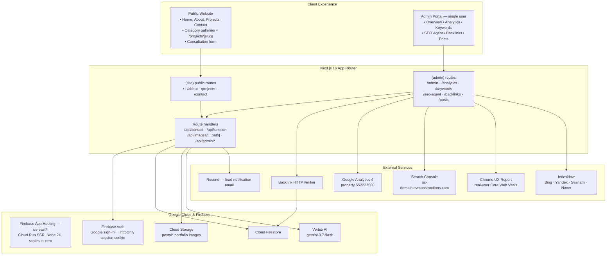
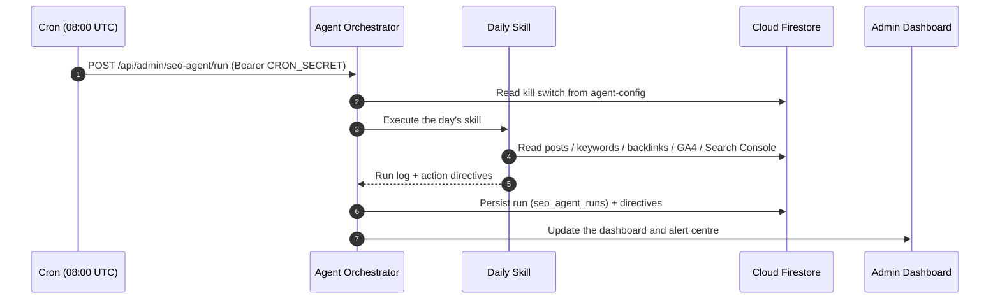

# EVR Construction LLC — Web Platform & Autonomous SEO Engine

> Next.js 16 platform for **EVR Construction LLC**, a licensed and insured deck,
> gazebo, railing and carpentry contractor in Knoxville, Tennessee, serving
> Knoxville and the surrounding East Tennessee communities.

---

## 🏗️ System Architecture



**Firestore collections** (13, all named here because a collection that is absent
from this list is one nobody thinks to look in):

| Collection | Holds |
| :--- | :--- |
| `posts` | Project posts shown in the public galleries |
| `leads` | Consultation enquiries submitted through `/contact` |
| `activity_logs` | Lead events, written by `POST /api/contact` |
| `tracked_keywords` | Target queries the owner is aiming at |
| `backlinks` | Monitored citation URLs and their last verification |
| `admin_notifications` | Alert centre entries |
| `seo_agent_runs` | One document per skill execution |
| `seo_agent_directives` | Action items the agent has raised |
| `agent-config` | SEO agent kill switch and persisted config |
| `content_briefs` | Posting briefs written by Thursday's skill |
| `rate_limits` | Firestore-backed request budgets, shared across instances |
| `locks` | Cross-instance locks for the agent and verifier |
| `integrations` | Per-provider settings (e.g. the Search Console site URL) |

---

## 🚀 Key Features

### 1. Public site and portfolio

- **App Router rendering.** The four main pages are statically prerendered.
  `/projects/[slug]` is `force-dynamic`: a new post appears on the site the moment
  it is published, with no cache to invalidate.
- **Service areas in one place.** Every surface that names a place — homepage
  chips, `areaServed` JSON-LD, the Posts Manager dropdown, geo detection and the
  agent's city briefs — derives from `SITE.serviceAreas` in `src/lib/site.ts`.
  Adding a city there updates all of them.
- **Structured data.** JSON-LD for `WebSite`, `HomeAndConstructionBusiness`,
  `DeckContractor`, `FAQPage` and `ItemList`, alongside per-page canonicals.
- **Consultation pipeline.** `POST /api/contact` validates and rate-limits the
  submission, writes a `leads` document, records an `activity_logs` event, and
  sends the owner an email through Resend.
- **Galleries.** Public category pages read `posts` where `published == true` and
  merge them with the static portfolio.

### 2. Admin portal (`/admin`)

Single-user, gated to `contact@evrconstructions.com` by Google sign-in plus an
httpOnly session cookie. Every `/api/admin/*` handler verifies that session first.

- **Overview** — lead counts, recent posts and SEO agent run cleanliness.
- **Analytics** — enquiry activity from `activity_logs`, alongside GA4 traffic.
- **Keywords** — tracked targets merged with live Search Console positions, clicks
  and CTR. Rows Google reports but the owner has not added as targets are marked
  as such and are read-only. A panel below the table lists every published URL with
  Google's own verdict from the URL Inspection API.
- **SEO Agent** — the seven-skill orchestrator described below.
- **Backlinks** — citation registry with a live HTTP verifier that records status,
  bot-challenge responses, and the `rel` of the link back to this site.
- **Posts Manager** — image upload to Cloud Storage with AI-assisted captioning.

### 3. Autonomous 7-day SEO agent

Seven skills, one per weekday, selected by UTC day and run either from the
dashboard or by the cron workflow at 08:00 UTC.

| Day | Skill | What it does |
| :--- | :--- | :--- |
| Mon | Keywords & Ranking Tracker | Scans Search Console queries and tracked targets |
| Tue | Citation & Backlink Verifier | Crawls every tracked listing for live status |
| Wed | Technical & On-Page Auditor | Audits schema, metadata, crawlability, and real-user Core Web Vitals |
| Thu | Local Coverage & Content Drafts | Reviews city coverage and writes posting briefs |
| Fri | Conversion & Traffic Synthesizer | Reads GA4 lead and call events |
| Sat | Project Post Geo-Enhancer | Audits published posts for alt text and geo detail |
| Sun | Weekly Digest & Action Synthesizer | Summarises the week into directives |



Run history is persisted, so the dashboard rebuilds each skill's last status and
findings count on a cold start rather than showing every skill as idle.

Wednesday is the broadest skill. Beyond schema and metadata it fetches Google's
own index verdict for every published URL, crawls the site checking titles,
canonicals, H1s, meta descriptions and internal links, reads real-user Core Web
Vitals from the Chrome UX Report, and submits the sitemap to IndexNow. Each of
those four checks is independently guarded, so one integration failing reports a
finding instead of losing the rest of the audit.

> **IndexNow key file.** Search engines verify ownership by fetching
> `https://evrconstructions.com/<key>.txt`, which `src/proxy.ts` rewrites to
> `/api/indexnow/key`. The key is read from the environment, so it can be rotated
> without a deploy. It is deliberately served from the **root**: the protocol
> scopes a key to the directory its file sits in, so a key under `/api/` would
> authorise only `/api/` URLs and every real page would be rejected.

---

## 🛠️ Technology Stack

| Layer | Technology | Notes |
| :--- | :--- | :--- |
| Framework | Next.js 16 App Router (Turbopack) | SSR plus route handlers |
| Language | TypeScript 5 (strict) | |
| UI | React 19 · Tailwind CSS v4 | |
| Runtime | Node 24 | Pinned via `engines.node`; matches App Hosting's `nodejs24` |
| Hosting | Firebase App Hosting | Cloud Run SSR in `us-east4`, scales to zero |
| Database | Cloud Firestore | |
| Storage | Cloud Storage for Firebase | `posts/*` |
| Auth | Firebase Admin SDK | Google sign-in, httpOnly session cookie |
| AI | Vertex AI `gemini-3.7-flash` | Captioning and keyword discovery |
| Performance | Chrome UX Report API | Real-user Core Web Vitals (API key, not OAuth) |
| Indexing | IndexNow | Instant URL submission to Bing and partners |
| Email | Resend | Lead notifications |
| Tests | Vitest | `tests/`, run with `npm test` |

---

## 📁 Repository Structure

```
evrconstruction/
├── .github/
│   ├── instructions/           # Agent customisation for this repo
│   └── workflows/
│       ├── build.yml           # lint · test · build on push and PR
│       └── seo-agent-cron.yml  # daily 08:00 UTC agent trigger
├── docs/                       # Audit reports and working notes
├── public/
│   └── images/                 # Portfolio images and site logos
├── src/
│   ├── proxy.ts                # Host canonicalisation + junk-path 410s
│   ├── app/
│   │   ├── (admin)/admin/      # Overview · Analytics · Keywords
│   │   │                       # SEO Agent · Backlinks · Posts
│   │   ├── (site)/             # Home · About · Projects · Contact
│   │   ├── api/                # contact · session · images · indexnow
│   │   │                       # · admin/*
│   │   ├── layout.tsx          # Fonts, metadata, icons, JSON-LD
│   │   ├── robots.ts           # robots.txt
│   │   └── sitemap.ts          # sitemap.xml
│   ├── components/
│   │   ├── admin/              # Sidebar, topbar, layout shell
│   │   └── site/               # Header, footer, forms, galleries
│   ├── lib/
│   │   ├── integrations/       # GA4, Search Console, Vertex AI, Google
│   │   │                       # auth, CrUX, IndexNow, backlink verifier
│   │   ├── seo-agent/          # Orchestrator, crawl audit, directive
│   │   │   └── skills/         # lifecycle, and the seven daily skills
│   │   ├── auth-guard.ts       # Admin session verification
│   │   ├── firebase-admin.ts   # Admin SDK initialisation
│   │   ├── posts.ts            # Post type, categories, upload limits
│   │   ├── services.ts         # Service catalogue
│   │   ├── site.ts             # Site details and service areas
│   │   └── storage-src.ts      # Image source resolution
│   └── types/
├── tests/                      # Vitest suites (tests/lib, tests/api)
├── apphosting.yaml             # App Hosting runtime and environment
├── firestore.rules             # Firestore access rules
├── storage.rules               # Cloud Storage access rules
└── next.config.ts              # Headers, image domains, rewrites
```

---

## ⚙️ Environment Variables

App Hosting reads these from `apphosting.yaml`. Values marked *secret* are stored
in Secret Manager; the rest are plain configuration.

```env
# Firebase web client (public — shipped to the browser)
NEXT_PUBLIC_FIREBASE_API_KEY=<secret>
NEXT_PUBLIC_FIREBASE_AUTH_DOMAIN=evrconstruction-5f7bd.firebaseapp.com
NEXT_PUBLIC_FIREBASE_PROJECT_ID=evrconstruction-5f7bd
NEXT_PUBLIC_FIREBASE_STORAGE_BUCKET=evrconstruction-5f7bd.firebasestorage.app
NEXT_PUBLIC_FIREBASE_MESSAGING_SENDER_ID=573736586147
NEXT_PUBLIC_FIREBASE_APP_ID=1:573736586147:web:f2ece9a7f6a910e72c6816
NEXT_PUBLIC_FIREBASE_MEASUREMENT_ID=G-19DRNQBM8T
NEXT_PUBLIC_RECAPTCHA_SITE_KEY=6LfA8aUtAAAAAK9RJDiKsWe1qg9t-ZuqsP4tjdMz

# Server credentials (secret)
FIREBASE_SERVICE_ACCOUNT_KEY=<secret>
FIREBASE_ADMIN_SERVICE_ACCOUNT_KEY=<secret>

# Lead email (secret) and sender address
RESEND_API_KEY=<secret>
EMAIL_FROM=onboarding@resend.dev

# Bearer token the daily cron workflow presents to the agent endpoint (secret)
CRON_SECRET=<secret>

# Google API key restricted to the Chrome UX Report API (secret).
# This API rejects OAuth, so a key is the only way in.
CRUX_API_KEY=<secret>

# IndexNow key, published at /<key>.txt to prove host ownership (secret).
# Not confidential — publishing it is how ownership is proved — but it is read
# from the environment so it can be rotated without a code change.
INDEXNOW_KEY=<secret>
```

The admin email is **not** an environment variable — `src/lib/auth-guard.ts` pins
it to `contact@evrconstructions.com`.

`EMAIL_FROM` is currently Resend's sandbox sender, which only delivers to the
account owner. Switch it to `"EVR Construction <contact@evrconstructions.com>"`
once the domain is verified in Resend.

---

## 💻 Local Development

```bash
git clone https://github.com/evrconstruction/evrconstruction.git
cd evrconstruction
npm install
npm run dev          # http://localhost:3000
```

Create `.env.local` with the variables above before running the admin suite.

`CRUX_API_KEY` must be a real Google-issued API key (they start `AIza`), created in
APIs & Services → Credentials and restricted to the Chrome UX Report API.
`INDEXNOW_KEY` is different — no one issues it; generate one with
`openssl rand -hex 32`. Any 8–128 characters of `a-z A-Z 0-9 -` will do.
With either unset the agent reports the gap as a finding rather than failing.

Verification — all four must pass before a change is considered done:

```bash
npm run lint         # ESLint
npm test             # Vitest
npm run build        # Production build + type check
```

---

## 🚢 Deployment

Push to `main` on `evrconstruction/evrconstruction`:

- **Firebase App Hosting** builds and deploys the SSR bundle to Cloud Run in
  `us-east4`. This is the only deploy path.
- **GitHub Actions** (`build.yml`) runs lint, tests and a build against the same
  push as a separate check.

Both run per push, so a single push produces two builds.

---

© 2026 EVR Construction LLC. All rights reserved.
