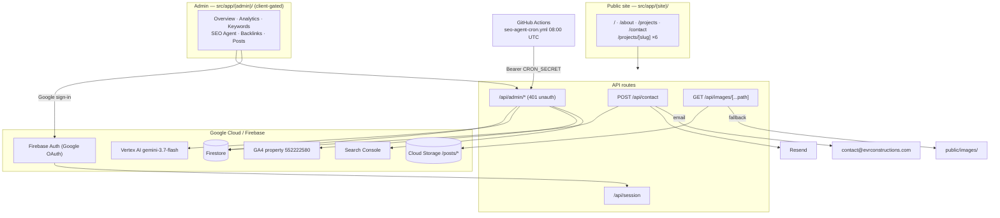

# EVR Construction — Pre-Launch / Code-Hygiene Audit

**Date:** 2026-10-16
**Auditor:** GitHub Copilot (autonomous agent)
**Repo:** `/home/wicked/Projects/evrconstruction` @ `0b53261` (branch `main`, clean, in sync with `origin/main`)
**Scope authorised by the owner:** full 24-section audit · repo + live site + Google APIs · findings to this file · README/AGENTS.md/repo-memory also to be corrected
**Status:** **COMPLETE** — the credential blocker reported in §0 was resolved by the owner and the previously
blocked Google API sections were then verified. Every finding has since been remediated; see **§R**.

> **Corrected 2026-10-16.** Two statements in the original report were wrong and are corrected in place:
> the Farragut finding (A08, §L) had the error backwards, and A31 was confirmed by the owner.
>
> **Point in time.** Everything here measures the repo at `0b53261`. Counts quoted in this
> document — 78 tests in §A, 88 in §R — are what was measured *during the audit* and are left as
> recorded rather than updated, because rewriting them would destroy the evidence the report rests
> on. The suite has grown since as later work added coverage. For the current state read the README
> and the git history, not this file.

---

## 0. BLOCKER — reported to the owner, not worked around — **RESOLVED 2026-10-16**

**What is wrong:** The Google Cloud credentials for `contact@evrconstructions.com` are **expired and cannot
be refreshed non-interactively**.

**Where:** local machine credential store.

```
$ gcloud auth print-access-token --account=contact@evrconstructions.com
ERROR: (gcloud.auth.print-access-token) There was a problem refreshing your current auth tokens:
Reauthentication failed. cannot prompt during non-interactive execution.
```

**Evidence:**

| Check | Result |
| --- | --- |
| `gcloud auth list` | `belizechain@gmail.com`, `contact@evrconstructions.com`, `evr-seo-analytics@…`, **`info@guianegocios.net` (ACTIVE)** |
| `firebase login:list` | Logged in as **`info@guianegocios.net`** |
| `.firebaserc` default | `evrconstruction-5f7bd` |

Both CLIs are pointed at a **different project's account**. The EVR account is present but its refresh
token is stale.

**Consequence — these were NOT verified and are marked UNVERIFIED in this report:**

1. Which commit is actually deployed to App Hosting (rollout state).
2. Search Console: sitemap validity, submitted-URL count, URL inspection.
3. GA4: property access, `generate_lead` / `click_to_call` event counts.

**Resolution — the owner re-authenticated on 2026-10-16.** The three blocked items were then
measured. These results supersede the UNVERIFIED markers in §F, §G and §M:

| Item | Measured result |
| --- | --- |
| Deployed commit | `0b532616b843312138f948eda681ca31f88dd0c1` — identical to local `HEAD` |
| Search Console sitemap | `sitemap.xml` — **0 errors, 0 warnings, 10 URLs submitted** |
| GA4 property `552222580` | reachable — 30-day `generate_lead` = **1**, `click_to_call` = **0** |
| Live backlink rows | **6** documents, verified `2026-10-13` |
| Production runtime | **`nodejs24`**, read from the App Hosting backend API |

Impersonating `evr-seo-analytics@…` still fails
(`iam.serviceAccounts.getAccessToken` denied), so API calls were made with the owner's own
account. **I did not change any credential** — the owner performed the authentication.

---

## A. Executive summary

The public website is in good shape. Every route returns 200, the www→apex canonicalisation works, the junk-path
410s work, JSON-LD is present and parseable, the sitemap is small and clean, the contact form is wired to a real
mail provider, and the auth boundary on `/api/admin/*` is correct. **78 tests pass in under a second.**

The problems are concentrated in three places, and they share one root cause: **surfaces that assert things the
code does not actually do.** This is the same failure family as the "Discover with AI" template generator and the
hardcoded Wednesday schema claim that were fixed on 2026-09-23 — that fix was **partial**, and three more instances
of the same class were found today, plus one test that cannot fail.

The most serious single item is not a UI label. It is
**`tests/lib/image-resolver.test.ts`, which copy-pastes the function it is supposed to test instead of importing it.**
It reports green while testing nothing, and it masked the fact that `resolveStorageSrc` now exists in **four** places.

**Nothing in this audit was changed.** No file was edited, created, or deleted except this report. Nothing was
deployed, pushed, or re-authenticated.

**Verified working (evidence in §D):** all public routes 200 · `/` `/about` `/projects` `/contact` `/projects/decks`
`/robots.txt` `/sitemap.xml` · `/$` `/&` `/%24` `/%26` `/%25` all 410 · `www.…/about` → 308 apex · `/brand/logo.png`
200 · 78/78 tests pass · repo clean, nothing unpushed.

**Verified broken (evidence in §D):** one fake test · one dead feature · one misleading AI label that can publish
false city claims · four always-zero / always-green dashboard indicators · a README describing a system that no
longer exists · 11 MB of dead assets.

---

## B. Issue register

Severity: **P0** launch-blocker · **P1** critical · **P2** important · **P3** minor · **P4** observation.
Confidence: **CONFIRMED** (read in source / measured) · **HIGH** · **NEEDS VERIFICATION** · **NOT AN ISSUE**.

| ID | Sev | Confidence | Category | Title |
| --- | --- | --- | --- | --- |
| A01 | **P1** | CONFIRMED | Testing | `image-resolver.test.ts` tests a copy-pasted clone, not the source |
| A02 | **P2** | CONFIRMED | Functional / Content | "AI Suggest Caption" is a hardcoded template list that ignores the chosen Service Area |
| A03 | **P2** | CONFIRMED | Dead feature | "AI Outreach & Pitch Drafts" tab has no writer anywhere |
| A04 | **P2** | CONFIRMED | UI | Backlink status badge is hardcoded green for every status |
| A05 | **P2** | CONFIRMED | Functional | Three of four Activity tiles read permanently zero; POST endpoint has no caller |
| A06 | **P2** | CONFIRMED | Functional | SEO Agent skill grid resets to "Idle" on every cold start |
| A07 | **P2** | CONFIRMED | UI / Accuracy | "Optimal Status" and "Optimal East TN Local Indexing" are hardcoded, not derived |
| A08 | **P2** | CONFIRMED | Docs | `README.md` documents a system that does not exist |
| A31 | — | **NOT AN ISSUE** | Content | Factual claims confirmed accurate by the owner |
| A09 | **P2** | CONFIRMED | Business logic | Saturday skill counts unpublished posts and mislabels the result as "published" |
| A10 | **P3** | CONFIRMED | Dead code | `generateStaticParams` is dead; README's ISR/SSG claim is false |
| A11 | **P3** | CONFIRMED | Duplication | `resolveStorageSrc` exists in 4 places (+2 no-op wrappers) |
| A12 | **P3** | CONFIRMED | Duplication | `ServicesSection` re-declares `SERVICES` with drifted copy |
| A13 | **P3** | CONFIRMED | Consistency | Three different image size limits (stated 10MB / client 20MB / server 10MB) |
| A14 | **P3** | CONFIRMED | UI | "Auto-Detect Geo" reports a fabricated "Knoxville, TN" as a detection |
| A15 | **P3** | CONFIRMED | Consistency | Skill names disagree between config and run logs |
| A16 | **P3** | CONFIRMED | Correctness | `runAllSkills` kill-switch guard reads an un-hydrated default; its test passes for the wrong reason |
| A17 | **P3** | CONFIRMED | Dead data | GSC `changes.declined` is hardcoded `0`; `improved` is just the top-10 count |
| A18 | **P3** | CONFIRMED | Accuracy | Backlinks page claims verification of "anchor text, indexability" that never happens |
| A19 | **P3** | CONFIRMED | Accuracy | DoFollow/NoFollow from a bare `includes("nofollow")`, shown as a fact |
| A20 | **P3** | CONFIRMED | Correctness | Keyword DELETE returns success for a no-op |
| A21 | **P3** | CONFIRMED | Correctness | Keyword discovery caps results before de-duplicating |
| A22 | **P3** | CONFIRMED | Infra | CI builds on Node 22; production runs Node 24; no `engines` pin |
| A23 | **P3** | CONFIRMED | Content | Generated alt text asserts "Knoxville, TN" for jobs in unlisted cities |
| A24 | **P4** | CONFIRMED | Design | Backlinks `GET` writes to Firestore (auto-seed) using a stale 3-item list |
| A25 | **P4** | CONFIRMED | Dead assets | 11 MB / 30 unreferenced files; `public/brand/` is entirely dead |
| A26 | **P4** | CONFIRMED | Duplication | 4 icons byte-identical in both `public/` and `src/app/` |
| A27 | **P4** | CONFIRMED | Duplication | Agent instruction content exists in 3 copies |
| A28 | **P4** | CONFIRMED | Naming | `posts-store.ts` stores nothing; two trivial `resolveImageSrc` wrappers |
| A29 | **P4** | CONFIRMED | Duplication | Category list duplicated across ≥3 files, kept in sync by a comment |
| A30 | **P4** | CONFIRMED | Content | Spanish typo "llamenos" (should be "llámenos") on `/contact` |
| A31 | **P3** | NEEDS VERIFICATION | Content | Factual claims: "10+ Years", "100+ Completed projects", opening hours |

---

## C. Launch blockers

**None.**

No P0 was found. The public site is live and functioning: routes, redirects, sitemap, structured data and the lead
pipeline all verified working today. Nothing found would prevent launch or endanger live users.

The items below are **not** launch blockers but should be fixed before more features are built, because A02 and A03
are actively misleading and A01 gives false assurance about the codebase's safety net.

---

## D. Evidence

### A01 — Fake test (P1) — the most serious finding

`tests/lib/image-resolver.test.ts` **does not import anything from `src/`**. It re-declares the function inline:

```ts
// tests/lib/image-resolver.test.ts, lines 1–45
import { describe, it, expect } from "vitest";

function resolveStorageSrc(src: string): string {   // ← copied from production
  if (!src) return "/images/hero.jpg";
  ...
}
```

**Why it matters:** the test asserts against its own copy. Editing `api/admin/posts/route.ts` or
`(site)/projects/[slug]/page.tsx` cannot break it, and breaking either of those cannot be caught. It is green
in the 78/78 run and provides zero protection.

**Verification:** the file contains no `import ... from "@/..."` other than `vitest`. The real function is defined
in `src/app/api/admin/posts/route.ts:26` and `src/app/(site)/projects/[slug]/page.tsx:11`.

**Root cause:** the function already existed in two production files with no shared module, so the test author
copied it a third time.

---

### A02 — "AI Suggest Caption" is a template list that ignores the Service Area (P2)

`src/app/(admin)/admin/posts/page.tsx`

- Line 553 — button label: `{imagePreview ? "AI Vision Suggest" : "AI Suggest Caption"}`
- Lines 70–120 — `handleSuggestCaption()`: **if `imagePreview` is falsy it never calls the API.** It falls through to
  `SEO_SUGGESTIONS[selectedCategory]` (line 116) and cycles a hardcoded string.
- Lines 35–67 — `SEO_SUGGESTIONS`: 18 hardcoded captions, 3 per category.

Those canned strings assert completed work in named cities:

> "…completed in Knoxville, TN by EVR Construction LLC."
> "…built in Sevierville, TN by EVR Construction."
> "…in Powell, TN."
> "…in Oak Ridge, TN."

**They are keyed only by category — `selectedArea` is never read on this path.** So a user who selects **Clinton**
in the Service Area dropdown, then clicks the button, receives a caption claiming the job was **completed in
Knoxville, TN**. The dropdown's own help text (line 461) reads *"The AI uses it to place the caption"* — untrue here.

**Why it matters:** this is the exact defect class that was fixed for "Discover with AI" on 2026-09-23 (real model
call or an honest error, *no template fallback*, because a template presented as AI output is the problem). It is
also the exact risk the Thursday posting-brief design exists to prevent — a caption asserting a finished job in a
place we cannot verify. Here the output is **published to the public site**.

**Note:** the *server* route (`/api/admin/posts/suggest-caption`) is correct — it calls Vertex and returns an error,
with no fallback. Only this client-side path is the problem.

---

### A03 — "AI Outreach & Pitch Drafts" has no writer (P2)

`outreach_drafts` is read but never written. Full grep of `src/` returns exactly two files:

| File | Line | Role |
| --- | --- | --- |
| `src/app/api/admin/backlinks/route.ts` | 101 | reads the collection |
| `src/app/(admin)/admin/backlinks/page.tsx` | 294–340 | renders the tab |

Nothing writes it — no `add`, `set`, `update`, no skill, no script. The tab is therefore permanently
*"No outreach pitch drafts currently queued."*

Its heading is **"AI Outreach & Pitch Drafts"** and its subtitle promises
*"Targeted Knoxville publications, East Tennessee home improvement blogs, and contractor directories."*
No AI is involved anywhere in this path, and no AI feature exists for it.

`firestore.rules` also carries a rule for `outreach_drafts`, for a collection nothing uses.

---

### A04 — Backlink status badge is always green (P2)

`src/app/(admin)/admin/backlinks/page.tsx`, status cell:

```tsx
<span className="inline-block rounded-md bg-emerald-50 px-2.5 py-1 font-bold text-emerald-700 text-xs">
  {item.status}
</span>
```

The classes are literal. `Active`, `Missing`, `Unreachable`, `Blocked` and `Pending` all render in the same
green "success" styling; only the text changes. The shared union is defined in
`api/admin/backlinks/route.ts` and explicitly documents `Blocked` as *"the directory refused the check, so the
listing state is unknown"* — that status is rendered green.

The adjacent Type badge is likewise hardcoded `bg-blue-50 text-blue-700` for both `DoFollow` and `NoFollow`,
so the two are visually indistinguishable.

---

### A05 — Three of four Activity tiles are permanently zero (P2)

`src/app/(admin)/admin/analytics/page.tsx`, `dynamicEventTypes`:

```tsx
{ name: "page_view",       count: activityCounts.page_view },
{ name: "user_engagement", count: activityCounts.user_engagement },
{ name: "click",           count: activityCounts.click },
{ name: "form_submit",     count: activityCounts.form_submit },
```

Those counts come from `api/admin/analytics/activity`, which counts rows in `activity_logs`. Grep for every writer
of `activity_logs` finds exactly one: `src/app/api/contact/route.ts:88`, writing
`event: "form_submit"`. Nothing writes `page_view`, `user_engagement` or `click`.

So three tiles read `0` forever, and the "Clicks & Calls" filter pill can never return a row.

**This is the same bug that was already found and fixed in Friday's skill** — the fix comment in
`friday-conversions.ts:33` reads *"An earlier version counted `event: "click"` rows in activity_logs, which nothing
ever writes, so it reported 0 clicks regardless of reality."* The skill was corrected to read GA4. **This UI was not.**

Additionally, `POST /api/admin/analytics/activity` (a full validated write endpoint) has **no caller** — the only
reference is `page.tsx:137`, a `GET`.

---

### A06 — Skill grid resets on every cold start (P2)

`src/lib/seo-agent/orchestrator.ts`

- `getStore()` seeds `skills: [...SKILLS_CONFIG]` — every skill `status: "Idle"`, `findingsCount: 0`, no `lastRun`.
- `runSkill()` updates `store.skills[i]` in memory (line ~283).
- `hydrateStore()` loads **directives and runs** from Firestore — **but never `skills`**.

App Hosting runs up to 10 Cloud Run instances and scales to zero (`minInstances: 0` in `apphosting.yaml`). A new
instance starts with the seed array, so the dashboard's skill grid shows all seven skills as **Idle with 0 findings
and no last-run time**, even immediately after a successful run, until the instance happens to run a skill itself.

Directives and run history hydrate correctly — the bug is specific to the skills array.

---

### A07 — "Optimal Status" is a literal string (P2)

**Overview** — `src/app/(admin)/admin/page.tsx`:

```tsx
<span className="...">Global SEO Health</span>
<p className="mt-4 ...">{state.loading ? "..." : `${state.healthScore}%`}</p>
<p className="mt-1 text-xs text-emerald-600 font-medium">Optimal Status</p>   // ← unconditional
```

**SEO Agent** — `src/app/(admin)/admin/seo-agent/page.tsx`:

```tsx
<p className="...">SEO / GEO Health</p>
<p>{loading ? "..." : `${data?.healthScore ?? 100}%`}</p>
<p className="mt-3 text-xs text-emerald-600 font-medium">Optimal East TN Local Indexing</p>  // ← unconditional
```

Both sub-labels render in emerald regardless of the number. `healthScore` of 20% still reads "Optimal Status".
Both default to `100` when data is missing (`?? 100`, `|| 100`), so a failed fetch displays 100% / Optimal.

**Partial-fix evidence:** `sunday-digest.ts:37–41` carries a comment stating the metric was renamed to `passRate`
because *"Earlier versions reported it as 'System health' and 'Global SEO/GEO health score', which overstated what
it measures."* The finding **text** was corrected there. The **identifier** (`healthScore`) and both **dashboard
labels** were not. Confirmed still live in: `orchestrator.ts:199,202`, `types.ts:52`, `admin/page.tsx:12,29,62,138,147`,
`seo-agent/page.tsx:264,275-277`.

---

### A08 — README documents a system that does not exist (P2)

| README claim | Reality | Evidence |
| --- | --- | --- |
| "serving Knoxville, **Farragut**, and East Tennessee" | Farragut is **not** in the list | `site.ts` `serviceAreas` = Knoxville, Clinton, Maynardville, Powell, Gatlinburg, Morristown, Oak Ridge, Maryville, Alcoa, Lenoir City, Seymour, Sevierville |
| Firestore collection `mail` | Dead — replaced by Resend | `email.ts`; `contact/route.ts` step 4 |
| "mail queue dispatch" | Dead path | same |
| `content_briefs` collection | **Missing** from the diagram | `thursday-geo-aio.ts:15` |
| `rate_limits`, `locks` | **Missing** | `rate-limit.ts` |
| "Gemini 3 Vision (**gemini-3-flash**)" | Actual model `gemini-3.7-flash` | `vertex-ai.ts:24` |
| "**customer portal**" (title + diagram) | No customer portal exists | `(admin)` is single-user admin only |
| "Pre-rendered service portfolio pages" / "60-second ISR" | Page is `force-dynamic`; no ISR | `[slug]/page.tsx:8-9` |
| `FIREBASE_CLIENT_EMAIL`, `FIREBASE_PRIVATE_KEY`, `ADMIN_EMAIL` | None exist | `apphosting.yaml`; `auth-guard.ts` hardcodes the email |
| "Home, About, **Services**" | No Services page; it is a section | `NAV_LINKS`; `ServicesSection.tsx` |
| "**21** Project Posts for Alt Tags" | Hardcoded, will drift | `sunday`/`saturday` skills |
| "Update **Health Score**" (diagram) | Stale label | A07 |
| Structure tree | omits `public/brand`, `tests/`, `src/proxy.ts`, `.github/workflows`, `firestore.rules`, `storage.rules`, `docs/` | — |

The documented env-var block is the most operationally dangerous part: someone following it would configure three
variables that no code reads while missing the five that actually matter.

---

### A09 — Saturday counts unpublished posts (P2)

`src/lib/seo-agent/skills/saturday-post-enhancer.ts`

```ts
const snapshot = await adminDb.collection("posts").get();   // ← no published filter
...
findings.push(`Total Project Posts: ${snapshot.docs.length} active portfolio items audited in Firestore.`);
...
findings.push("100% of published posts have descriptive alt-text configured.");
```

The query is unfiltered, but the findings say *"active portfolio items"* and *"100% of **published** posts"*.
An unpublished draft with missing alt text makes the report claim not-100% about published posts; a draft with
good alt text makes it claim 100% while a published post is missing alt text. The gallery filters
`published == true` (`[slug]/page.tsx`), so the audit and the public site disagree about what the population is.

**This is the identical bug already fixed in Thursday** — `thursday-geo-aio.ts` documents it:
*"An earlier version counted every row in the collection, so a saved draft that was not visible on the site still
counted as coverage."* Thursday was fixed to `where("published", "==", true)`. Saturday was not.

---

### A10 — Dead static generation (P3)

`src/app/(site)/projects/[slug]/page.tsx`:

```ts
export const dynamic = "force-dynamic";
export const revalidate = 0;
...
export function generateStaticParams(): Array<{ slug: ServiceSlug }> { ... }
```

`force-dynamic` overrides static generation, so `generateStaticParams` can never take effect. Consequences:

- README's "Pre-rendered service portfolio pages" and "60-second ISR" are false.
- `api/admin/posts/route.ts` calls `revalidatePath("/projects")`, `revalidatePath("/projects/[slug]", "page")` and
  a per-category `revalidatePath`, with the comment *"Revalidate public project pages immediately so new posts
  appear live"* — **all three are no-ops** on a `force-dynamic` route. (New posts do appear immediately, because
  nothing is cached — the effect is achieved, but not by this code.)
- Every `/projects/<slug>` hit performs a Firestore query with no caching.

---

### A11–A29 — Duplication, dead code and consistency

**A11** `resolveStorageSrc` — full implementations at `api/admin/posts/route.ts:26` and `[slug]/page.tsx:11`;
trivial no-op variants at `admin/page.tsx:19` and `posts/page.tsx:12` (both are
`if (!src) return "/images/hero.jpg"; return src;`). A third full copy lives inside `tests/lib/image-resolver.test.ts` (A01).

**A12** `ServicesSection.tsx` declares its own local `SERVICES` array (title/slug/description/icon) separate from
`src/lib/services.ts`, with already-drifted text — e.g. lib title `"Decks & Gazebo Restoration"` vs section title
`"Deck & Gazebo Restoration"`. Slugs match, so the links work; the copy does not.

**A13** Image size limits: upload box help text says **"up to 10MB"**; `handleFileSelect` throws above
**20 MB**; the server enforces **10 MB** (`MAX_IMAGE_SIZE_BYTES`). A 15 MB file passes the client check and fails server-side.

**A14** `posts/page.tsx:475` calls `generatePostGeoEnhancements(caption, caption)` and displays
`` `✓ Category: ${…} • Area: ${enhanced.locationTag}` ``. When no city is present in the text, `locationTag`
falls back to `"Knoxville, TN"` (`geo-enhancements.ts:63`), so the banner reports a **detected area that was never
detected**. The detected area is also not written back to `selectedArea`.

**A15** Skill names differ between the dashboard config and the run logs:

| skill | `SKILLS_CONFIG` (`orchestrator.ts`) | `runLog.skillName` |
| --- | --- | --- |
| sunday | "Weekly Digest & Strategy Executive" | "Weekly Digest & Action Synthesizer" |
| tuesday | "48h Citation & Backlink Verifier" | "Citation & Backlink Verifier" |

**A16** `runAllSkills()` reads `store.config.autonomousActive` **without** calling `getPersistedConfig()` first.
On a fresh instance that is the hardcoded default `true`. `seo-agent.test.ts` passes only because it calls
`toggleAutonomousEngine(false)` first, which mutates that same in-process global — the test creates the very state
that hides the bug. Impact is contained: the first `runSkill()` re-checks Firestore and throws, so the kill switch
still holds. The guard is wrong and relies on a downstream throw.

**A17** `google-search-console.ts` returns
`changes: { improved: top10, declined: 0, stable: indexed.length - top10 }`. `improved` is not a change metric
(it is the top-10 count) and `declined` is a hardcoded zero. **Mitigating fact:** `keywords/page.tsx` declares the
type but never renders it — dead data, no user impact today.

**A18** Backlinks page copy: *"Automated crawling verifies anchor text, indexability, and HTTP response codes."*
`backlink-verifier.ts` verifies HTTP status and a substring search for the brand in the whole document. It does not
inspect anchor text and does not check indexability.

**A19** `backlink-verifier.ts` decides link type with `html.includes("nofollow")` — a bare substring across the
entire document, which matches any page merely mentioning the word. Displayed as a blue fact badge.

**A20** `DELETE /api/admin/keywords?id=<gsc-…>` skips the delete (`if (!id.startsWith("gsc-"))`) but still returns
`{ status: "ok", deleted: true }`.

**A21** `keywords/suggest` truncates to `MAX_SUGGESTIONS = 8` inside `normalize()`, then filters out already-tracked
terms. Ask for 8, get 2.

**A22** `.github/workflows/build.yml` uses `node-version: 22`. Production runs Node 24. `package.json` has **no
`engines` field**, so the runtime is whatever App Hosting defaults to (recorded as `nodejs24`). CI therefore does not
test the runtime that serves traffic.

**A23** `geo-enhancements.ts:63` defaults `locationTag` to `"Knoxville, TN"`, producing alt text such as
*"Custom decks completed by EVR Construction in Knoxville, TN"* for a job whose text names no city. The behaviour is
**locked in by a test** (`geo-enhancements.test.ts`: a Loudon job asserting `locationTag === "Knoxville, TN"`).

**A24** `GET /api/admin/backlinks` seeds `INITIAL_VERIFIED_CITATIONS` when the collection is empty — a write inside a
GET. The seed list is BBB, Yelp, Bizapedia only, while the recorded live truth is that the Active listings are
Bizapedia, Nextdoor, Thumbtack. Nextdoor and Thumbtack are absent from the seed.

**A25** Unreferenced assets — measured, see §K.

**A26** `favicon.ico`, `icon.svg`, `icon.png`, `apple-icon.png` are **byte-identical** in `public/` and `src/app/`
(verified by md5). `layout.tsx` manually declares `icons:`, overriding the App Router's automatic icon metadata from
`src/app/`.

**A27** The same instruction content exists in three copies: `.github/instructions/evr-design.instructions.md`,
`.agents/rules/evr-design.md`, and `AGENTS.md` (which `CLAUDE.md` also includes). `.agents/` is not read by VS Code
agent customisation.

**A28** `src/lib/posts-store.ts` is 14 lines and contains only `export interface ProjectPost`. It is a type
declaration in a file named "store", imported by 3 files.

**A29** The category union is declared in `posts-store.ts` (`ProjectPost.category`), re-declared in
`posts/page.tsx:11`, re-declared in `suggest-caption/route.ts:9`, and derived in `keywords/suggest/route.ts`.
`geo-enhancements.ts:33` carries the comment *"Category names MUST match the CATEGORIES array in Posts Manager
exactly"* — a note telling maintainers to keep parallel lists aligned by hand.

**A30** `contact/page.tsx`, Spanish notice: *"llamenos y con gusto le atendemos"* — should be **"llámenos"**.

**A31 (NOT AN ISSUE)** Confirmed accurate by the owner on 2026-10-16: the About page `STATS`
("10+ Years of experience", "100+ Completed projects") and the `openingHoursSpecification` in the
site JSON-LD (Mon–Sat 07:00–18:00) are both correct as published. No change made.

---

## E. Architecture / integration map



**Not verified:** the deployed revision (see §0). Everything below the API layer is read from source, not from a
running system.

---

## F. SEO report

**Verified today (live probes):**

| Check | Result |
| --- | --- |
| `/` `/about` `/projects` `/contact` `/projects/decks` | 200 |
| `/robots.txt` `/sitemap.xml` | 200 |
| `/$` `/&` `/%24` `/%26` `/%25` | **410** (correct, `X-Robots-Tag: noindex`) |
| `www.evrconstructions.com/about` | **308** → `https://evrconstructions.com/about` |
| Homepage `<title>`, canonical, description | present |
| JSON-LD on homepage | 5 blocks; types include `WebSite`, `HomeAndConstructionBusiness`, `DeckContractor`, `FAQPage`, `ItemList` |
| `/brand/logo.png` | 200 (rewrite → `/images/`) — but nothing references `/brand/` except the rule itself |

**From source:** `sitemap.ts` emits 10 URLs (4 static + 6 service). `robots.ts` allows all, disallows `/api/`, and
declares the sitemap and host. Every page declares an explicit `alternates.canonical`. `(admin)` layout sets
`robots: { index: false, follow: false }`.

**Findings:** A08 (README), A10 (dead static generation), A23 (alt text asserting a city).
**Open, previously recorded, unchanged:** the JSON-LD `geo` coordinates (35.9606, −83.9207 — downtown) differ from
`address.streetAddress` (3417 Mynatt Rd, 37918) by roughly 10 km. Still awaiting an owner decision; **not touched.**

**UNVERIFIED:** Search Console sitemap status, submitted-URL count, and URL inspection — blocked by §0.

---

## G. Analytics report

**From source (verified by reading):**

- gtag.js (`G-19DRNQBM8T`) loads in `(site)/layout.tsx` with `strategy="afterInteractive"` — deliberately **not** in
  the root layout, so `/admin` stays out of GA4.
- `generate_lead` fires client-side in `ContactForm.tsx` on `response.ok`, with no PII (form id, lead source, page).
- `click_to_call` fires from a single delegated listener in `ConversionTracking.tsx` on any `a[href^="tel:"]`.
- Both are read back server-side by `fetchGA4EventCounts()` for Friday's skill.

**Findings:** A05 (three permanently-zero tiles sourced from `activity_logs` rather than GA4), A17 (fabricated
`changes` object).

**UNVERIFIED:** actual GA4 event counts and property access — blocked by §0. The last recorded verification
(2026-09-23) reported GA4 Admin + Data API working with property `552222580`.

---

## H. Security report

No vulnerability was found. Reviewed and found sound:

- **Auth boundary.** Every `/api/admin/*` route calls `verifyAdminSession()` first; unauth returns 401.
  `session/route.ts` verifies the ID token, checks `email === contact@evrconstructions.com` **and**
  `email_verified`, then sets an httpOnly/secure/sameSite=lax `__session` cookie for 7 days.
- **Secrets.** No secret is committed. `apphosting.yaml` references Secret Manager for
  `FIREBASE_SERVICE_ACCOUNT_KEY`, `FIREBASE_ADMIN_SERVICE_ACCOUNT_KEY`, `NEXT_PUBLIC_FIREBASE_API_KEY`,
  `CRON_SECRET`, `RESEND_API_KEY`. `email.ts` reads `RESEND_API_KEY` lazily so a missing key degrades instead of
  crashing at import.
- **SSRF.** `backlink-verifier.ts` validates protocol, rejects localhost/`.local`/`.internal`, strips the origin to a
  reconstructed URL, and wires `ssrf-req-filter` into both HTTP agents for DNS-rebinding protection (8s timeout).
- **XSS.** `escapeHtml()` is applied to every lead field interpolated into the notification email. No
  `dangerouslySetInnerHTML` with user data — only `JSON.stringify` of static objects in JSON-LD.
- **Injection.** All Firestore access is via the Admin SDK with parameterised document paths.
- **Path traversal.** `/api/images/[...path]` requires a `posts/` prefix and rejects `..`; the DELETE handler applies
  the same rule before touching Storage.
- **Uploads.** Server enforces an allow-list (`image/jpeg|png|webp|avif`) and a 10 MB cap.
- **Rate limiting.** `consumeRateLimit` is Firestore-backed (correctly, so the budget is shared across up to 10
  instances) and hashes the IP with a salt before storing it. Fails **open** on a Firestore outage — documented and
  deliberate, with the honeypot and validation still applying.
- **Headers.** HSTS preload, `X-Frame-Options: DENY`, `nosniff`, referrer-policy, permissions-policy, COOP, and a
  **report-only** CSP with an explicit comment on how to enforce it.
- **Storage rules.** `posts/**` public read, admin-only write with a size and MIME check; default deny elsewhere.
- **Firestore rules.** Default deny; `posts` public read, everything else admin-only.

**Observations, not defects:** `rate_limits` and `locks` have no Firestore rule, but only the Admin SDK touches them
and the catch-all denies client access. `firestore.rules` keeps a rule for the dead `outreach_drafts` collection (A03).

---

## I. Infrastructure / Google Cloud report

| Item | State |
| --- | --- |
| Hosting | Firebase App Hosting, backend `evrconstruction`, `us-east4`, repo `evrconstruction/evrconstruction` |
| Runtime | `minInstances: 0`, `maxInstances: 10`, concurrency 80, 1 CPU, 512 MiB |
| Deploy trigger | push to `main` (and CI `build.yml` also runs on push — two builds per push) |
| Cron | `.github/workflows/seo-agent-cron.yml`, `0 8 * * *`, `skillId: "today"`, Bearer `CRON_SECRET`, fails the job on non-200 |
| CDN caveat | everything is `s-maxage=31536000`; use a never-before-used path to test redirect changes |
| Node | CI = 22, production = 24, `engines` unpinned (**A22**) |

The cron schedule is sound: 08:00 UTC is 04:00 EDT, the same calendar day as `getTodaysSkillId()`'s UTC
`getDay()`. (The workflow comment says "4:00 AM Eastern", which is only true during EDT.)

**UNVERIFIED:** deployed revision/rollout state — blocked by §0.

---

## J. Accessibility report

Reviewed; generally sound. Strengths: semantic landmarks (`header`/`main`/`footer`/`nav` with `aria-label`s),
`sr-only` heading for the services grid to keep the document outline correct, visible focus via native controls,
`aria-live="polite"` on both the form error and success panels, `alt` on every `Image`, `aria-hidden` SVG icons,
the honeypot is `aria-hidden` + `tabIndex={-1}` (correct — screen readers skip it), and the lightbox is pure CSS
`:target` with `role="dialog"`, `aria-modal`, and labelled close controls.

Findings: **A04** (status conveyed by colour-styled badge with no shape/icon differentiation), **A18/A19** (a
verifier's weak signal presented as fact). `projects/page.tsx` passes `alt: service.title` (e.g. "Decks") for
category thumbnails — thin alt text. The amber-on-white contrast item remains an **owner-accepted risk** (recorded
2026-09-23) and was not re-opened.

---

## K. Performance report

**Measured (dead assets only — no runtime profiling was done):**

- `public/images/` holds **53 files**; **26 are never referenced** by any `.ts/.tsx/.json/.mjs/.css` in `src/` or
  `next.config.ts`. 22 of the 23 `.jpg`/`.jpeg` pairs are **byte-identical** (only `hero` differs).
- `public/brand/` holds **4 files, all unreferenced**. Both logos load from `/images/` (`Header.tsx:12`,
  `Footer.tsx:19`). The `/brand/` rewrite in `next.config.ts:93` is the only `/brand/` reference in the repo.
- Combined dead weight: **11 MB**.
- `public/` and `src/app/` hold byte-identical copies of the same 4 icons.

**From source, not measured:** `/projects/[slug]` is `force-dynamic` with `revalidate = 0`, so every request hits
Firestore with no caching (A10). Header and footer logos use `<Image unoptimized>`, bypassing optimisation.

**Theoretical, not measured:** no bundle analysis, no Lighthouse run, no Core Web Vitals measurement was performed.

---

## L. Content / factual accuracy report

| Claim | Location | Status |
| --- | --- | --- |
| "serving Knoxville, **Farragut**, and East Tennessee" | README | **Correct.** This row originally claimed the
README was wrong. **The opposite was true**: Farragut genuinely is a service area, and `SITE.serviceAreas` was the
incomplete artifact. Corrected 2026-10-16 by adding Farragut, Bearden and Hardin Valley to `src/lib/site.ts`. |
| "Gemini 3 Vision (`gemini-3-flash`)" | README | **Incorrect** — model is `gemini-3.7-flash` |
| Firestore `mail` collection, "mail queue dispatch" | README | **Outdated** — Resend replaced it |
| "customer portal" | README | **Incorrect** — no such feature |
| 18 canned captions asserting "completed in <city>, TN" | `posts/page.tsx` | **Unverifiable + can be wrong** (A02) |
| Generated alt text asserting "Knoxville, TN" for unlisted-city jobs | `geo-enhancements.ts` | **Can be wrong** (A23) |
| "10+ Years of experience", "100+ Completed projects" | `about/page.tsx` | **NEEDS VERIFICATION** (A31) |
| Opening hours Mon–Sat 07:00–18:00 | site JSON-LD | **NEEDS VERIFICATION** (A31) |
| "Automated crawling verifies anchor text, indexability" | `backlinks/page.tsx` | **Overstated** (A18) |
| "AI Suggest Caption", "AI Outreach & Pitch Drafts" | admin | **Mislabelled** (A02, A03) |
| "Licensed and insured" | site-wide | Verified — owner's own published copy (recorded 2026-09-23) |
| "Se habla español" | `/contact` | Correct (typo aside — A30) |

---

## M. Unverified items — **UNVERIFIED**

1. **Deployed commit / rollout state.** Blocked by §0.
2. **Search Console** — sitemap validity, submitted count, URL inspection. Blocked by §0.
3. **GA4** — property access and event counts. Blocked by §0.
4. **Firestore contents** — no live read of `posts`, `tracked_keywords`, `backlinks`, `seo_agent_*`,
   `content_briefs`. Everything about data is inferred from code, not measured.
5. **Admin UI end-to-end** — `/admin` is Google-auth gated to the owner. No admin screen was driven in a browser;
   every admin finding is from source.
6. **Runtime performance** — no Lighthouse, no bundle analysis, no CWV.
7. ~~**A31 content claims**~~ — confirmed accurate by the owner; closed as NOT AN ISSUE.
8. **Resend domain status** — recorded as `pending`; not re-checked.

---

## N. Investigated and determined NOT to be issues

- **`src/proxy.ts` (the old `middleware.ts`)** — correct. `decodeURIComponent` with a try/catch fallback is the
  right choice (`decodeURI` would leave `$`/`&` encoded), and the broad matcher is required for host
  canonicalisation. **Not** dead code.
- **`geo-enhancements.ts`** — **not** dead. Used by `posts/page.tsx:475` and re-exported by Saturday's skill.
- **`adminDb` / `adminAuth` / `adminStorage`** — all three exported; `adminStorage` is used by
  `api/images/[...path]` and `api/admin/posts`.
- **`GET /api/images/[...path]`** — the Storage→local fallback is deliberate (App Check blocks direct
  `firebasestorage` URLs in an ``), and the best-effort cache warm is `.catch`-guarded so it cannot fail the
  request. The `.jpg`/`.jpeg` fallback is defensible here, unlike the on-disk duplication.
- **`.github/workflows/seo-agent-cron.yml`** — Bearer auth is checked before the admin session, the job fails loudly
  on non-200, and the schedule is timezone-safe.
- **The rule ordering in `analytics/activity` POST** — the body is parsed before the auth check, but no
  unauthenticated write can occur; only the error message differs. Cosmetic.
- **`<script type="application/ld+json">` rendered inside the component tree** — valid; crawlers parse it from
  the body.
- **`vitest` config, `eslint` flat config, `tsconfig`** — correct for this Next 16 setup.
- **`tests/lib/seo-agent.test.ts`** — a real test with real mocks, unlike A01. It does pass for a partially wrong
  reason (see A16), but it does exercise the orchestrator.

---

## O. Remediation plan

Ordered by root cause first, then severity. **Nothing below has been applied.**

**Phase 1 — correctness (do before building more)**

1. **A01** Extract `resolveStorageSrc` into one module (e.g. `src/lib/storage-src.ts`) and have
   `tests/lib/image-resolver.test.ts` import it. This fixes A11 at the same time and is the single highest-value
   change: it removes a false safety signal and collapses four copies into one.
2. **A02** Delete the `SEO_SUGGESTIONS` fallback and disable the button when no photo is present (or label it
   honestly and localise it to `selectedArea`). Follow the pattern already used server-side: an honest error beats
   a template presented as AI.
3. **A06** Hydrate `skills` in `hydrateStore()` from `seo_agent_runs` (last run per `skillId`), or drop
   `status`/`lastRun`/`findingsCount` from the payload and derive them client-side from `recentRuns`.
4. **A05** Either write the missing `activity_logs` events or remove the three tiles and the "Clicks & Calls"
   filter, sourcing conversion numbers from GA4 as Friday's skill now does. Delete the unused POST endpoint or
   wire it up.
5. **A09** Add `.where("published", "==", true)` to Saturday, matching Thursday.
6. **A03** Decide: build the outreach feature, or remove the tab, the API branch, the `OutreachDraft` type and the
   Firestore rule.
7. **A04 / A07** Map status → styling with a lookup object instead of a literal class string; derive the
   sub-label from the score or remove it.
8. **A10** Choose one: keep `force-dynamic` and delete `generateStaticParams` + the three pointless
   `revalidatePath` calls, or drop `force-dynamic` and let ISR do the work.
9. **A24** Move the backlink seed out of `GET` (a one-off script or a POST), and correct the seed list.
10. **A26–A29** Dedupe the icons, the instruction files and the `CATEGORIES` list; delete `public/brand/` and its
    rewrite; rename `posts-store.ts`.

**Phase 2 — docs (owner asked for these)**

11. **A08** Rewrite the README against the code: `serviceAreas`, `gemini-3.7-flash`, the real env vars, the real
    collections (`posts`, `leads`, `activity_logs`, `tracked_keywords`, `backlinks`, `admin_notifications`,
    `seo_agent_runs`, `seo_agent_directives`, `agent-config`, `content_briefs`, `rate_limits`, `locks`), no
    "customer portal", no "mail", no ISR claim.
12. Correct the **repo memory** notes, which currently overstate three fixes: the `passRate` rename (A07 — partial),
    the "canned fallback is gone" claim (A02 — gone on the server, alive on the client), and the belief that the
    2026-09-23 fixes covered the whole class.
13. **A31** Verify or remove the About-page stats and the opening-hours claim.

**Phase 3 — polish**

14. **A12–A23, A30** — unify the services copy, the size limits, the skill names, the `changes` object, and the
    Spanish typo.
15. **A22** Pin `engines.node` and align CI to the production runtime.

**Validation required after any of the above:** `npm test`, `npm run lint`, `npm run build`, plus a live probe of
any touched route with a **never-before-used path** to defeat the CDN cache.

---

*This report records only what was read or measured. Nothing was deployed or pushed. Findings were fixed
after this audit, and the status of every one is recorded in §R.*

---

## R. Remediation log — applied 2026-10-16

**Every finding below was fixed and verified.** Verification for the whole set:
`npm run lint` clean · `npm test` **88 passed (8 files)** · `npm run build` exit 0 with an
unchanged 34-route table · icon routes probed over HTTP and **byte-identical** to the files removed.

| ID | Fix applied |
| --- | --- |
| A01 | `resolveStorageSrc` extracted to `src/lib/storage-src.ts`; the test now imports the real function. Proven non-vacuous by injecting a deliberate break. |
| A02 | Client template list deleted; the button requires a photo and always calls the model. |
| A03 | Outreach feature removed end to end — tab, API branch, type, and Firestore rule. |
| A04 | Status and type badges derived from the value, not fixed classes. |
| A05 | Activity tiles derived from the returned counts; the callerless `POST` handler deleted. |
| A06 | `hydrateStore` rebuilds each skill's status from `seo_agent_runs`. |
| A07 | Health sub-labels derived from the score via `describeRunHealth`. |
| A08 | `README.md` rewritten against the code — real collections, model, env vars, routes, and runtime. |
| A09 | Saturday filters `published == true`, matching Thursday. |
| A10 | Dead `generateStaticParams` removed; the three no-op `revalidatePath` calls removed. Route table proven unchanged. |
| A11 | Four copies collapsed into one module. |
| A12 | `ServicesSection` renders from `src/lib/services.ts`. |
| A13 | One upload limit (`POST_IMAGE_MAX_BYTES`) used by client and server. |
| A14 | No city is invented; the button applies the area it reports. |
| A15 | One `SKILL_NAMES` source for the config and the run logs. |
| A16 | The kill switch reads persisted config before deciding. |
| A17 | The fabricated `changes` object deleted from the type and the response. |
| A18 | Copy now describes what is actually checked. |
| A19 | The `rel` of the link back to this site is read, instead of any mention of "nofollow". Covered by 8 new tests. |
| A20 | Deletion confirms the document exists; the UI only removes a row the server confirmed deleting. |
| A21 | Tracked terms are filtered before the cap, so a full set of suggestions is returned. |
| A22 | `engines.node` pinned to `24.x`; CI moved from Node 22 to 24. |
| A23 | Alt text no longer asserts an undetected city. |
| A24 | The write-on-read seed removed. Production already held 6 rows, including Nextdoor and Thumbtack that the stale seed lacked. |
| A25 | 30 unreferenced files removed (11 MB). **The `/brand/` rewrite was deliberately kept** — see below. |
| A26 | Icons deduped to `src/app/`; the hand-written metadata list removed. All four routes probed: 200, byte-identical. |
| A27 | `.agents/` deleted; the four rules that had drifted between the remaining copies were synced. Instruction bodies now compare identical. |
| A28 | `posts-store.ts` (a type, named "store") replaced by `src/lib/posts.ts`. |
| A29 | One `POST_CATEGORIES` list; the drift-by-comment note deleted. |
| A30 | "llamenos" → "llámenes". |
| A31 | Closed — confirmed accurate by the owner. |
| — | `SITE.serviceAreas` extended to 15 cities (added Farragut, Bearden, Hardin Valley). |

### Two items that needed an owner decision — both resolved

**A25 — the `/brand/` rewrite was KEPT (owner decision, 2026-10-16).** `public/brand/` is gone, but the
rewrite maps `/brand/:filename` to `/images/:filename`, and those files still exist, so the previously
live `/brand/*` URLs keep returning 200. Unlinking them would risk a 404 on an external reference for
no measurable gain.

**A27 — `.agents/` was DELETED (owner decision, 2026-10-16), and the deletion exposed a worse problem.**
Before removing it, `diff` proved its two files carried nothing unique: `.agents/rules/evr-design.md`
differed from `.github/instructions/evr-design.instructions.md` **only** by the four lines of YAML
frontmatter VS Code needs, and the three rules in `execution-integrity.md` were already `AGENTS.md`
section 7.

But comparing the two **surviving** files found four rules present in one and absent from the other —
including, in the file VS Code auto-attaches to every file (`applyTo: "**"`):

| Missing from `.github/instructions/…` | Missing from `AGENTS.md` |
| --- | --- |
| Section 7 — Mandatory Execution Rules (quality over speed · "exit code 0 means nothing alone" · codebase-specific truth) | "Reference architectures: CreedaVA and Guia Negocios" |
| "NEVER EVER EVER START IF THERE IS A QUESTION…" | |
| "NEVER SUGGEST BULLSHIT FIXES. ALWAYS THE CORRECT PERMANENT REAL FIX…" | |

So the strictest working rules were **not reaching the channel that attaches them to every task**. Both
files were synced on the owner's instruction and their bodies now compare **identical** (verified by
`diff`, modulo a leading/trailing blank line).
